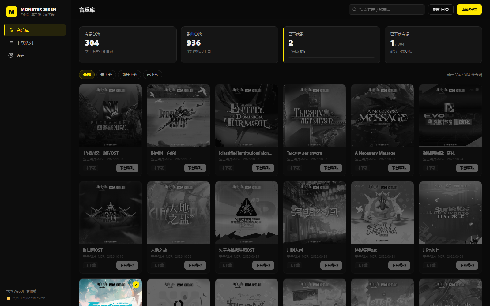
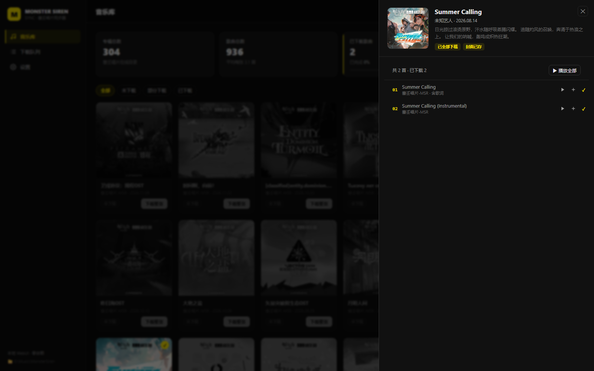
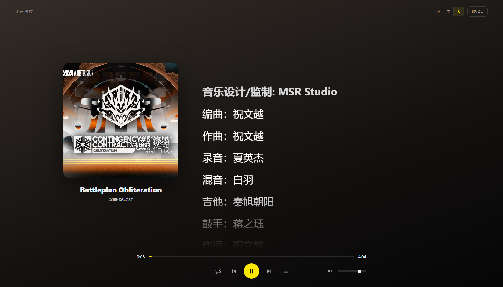
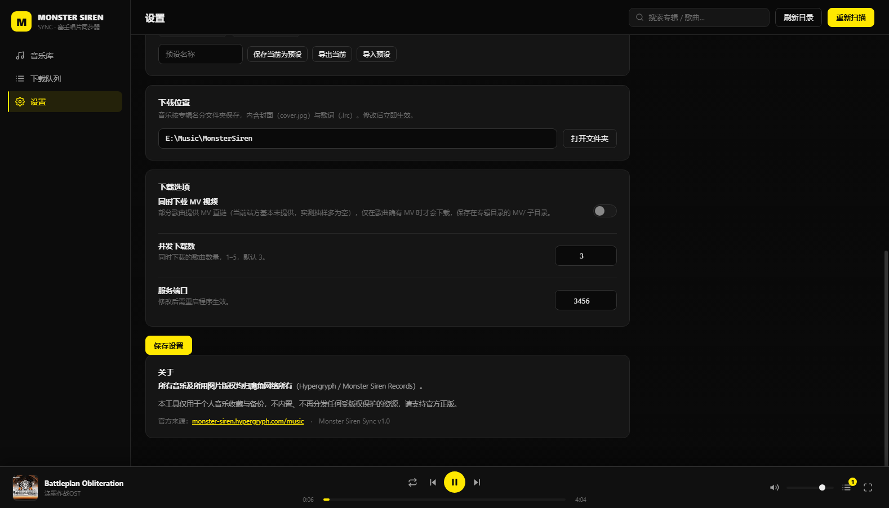

# 塞壬唱片同步器 · Monster Siren Sync

> **📥 [下载单文件 exe（Windows）](https://github.com/basilisk867/monster-siren-sync/releases/latest/download/siren-sync.exe)** —— 无需安装 Node.js，双击即用。

把 [塞壬唱片（Monster Siren）](https://monster-siren.hypergryph.com/music) 的音乐按专辑增量同步到本地：界面里逐张浏览、手动勾选下载，只拉本地没有的部分，并内置本地播放器与滚动歌词。

- 零依赖：只用 Node.js 内置模块，无需 `npm install`
- 本地 WebUI：布局参考 shadcn dashboard，暗色 + 标志黄，支持日间模式与自定义主题
- 增量下载：以本地文件为准，已下载的自动跳过；下载音频时同时下载歌词、首次补封面
- 专辑结构：`<下载根>/<专辑名>/`，文件名前缀 `01 -`、`02 -` 严格按专辑内歌曲顺序
- 内置播放器：底部播放条 + 全屏播放页 + 滚动歌词，自定义播放列表（可拖拽排序），关闭浏览器后播放列表与播放进度自动恢复



## 环境要求

- Node.js ≥ 18（推荐 20/22/24）
- 能访问 `monster-siren.hypergryph.com` 与 `*.hycdn.cn` 的网络
- 磁盘空间：单曲 4–115 MB（82% 为 wav、18% 为 mp3），按需下载，全量约 37 GB

## 快速开始

**方式一：单文件 exe（推荐，无需安装 Node.js）**

双击 `siren-sync.exe` 即可，会自动打开浏览器。首次运行会在 exe 旁边生成 `config.json`。

> 如果默认下载目录（用户「音乐」文件夹）被安全软件拦截而不可写，程序会自动改用 exe 目录下的 `downloads/` 并在控制台提示。

**方式二：源码运行（需要 Node.js ≥ 18）**

```bash
node server.mjs
```

或双击 `start.bat`。启动后自动打开 <http://127.0.0.1:3456>（端口被占用时自动顺延）。

> 注意：`start.bat` 必须保持 **ASCII + CRLF** 编码，用编辑器改动时不要存成 UTF-8 或 LF。

## 常见问题

- **安全软件拦截（卡巴斯基 / 火绒 / 360 等）**：未签名的 exe 可能被限制写入用户目录。程序已自动降级到 exe 旁的 `downloads/`；也可以把 exe 加入杀软白名单，或把 exe 放在非 C 盘目录运行。
- **端口被占用**：自动顺延到 3457、3458…
- **MV 下载**：站方接口目前基本不提供 `mvUrl`（实测抽样 80 首全为 null），开关打开后也只会在有 MV 时下载。

## 界面

| 专辑详情 | 全屏播放（封面取色 + 滚动歌词 + 字号） |
|---|---|
|  |  |

| 日间模式 + 自定义背景 | 设置页（外观 / 预设 / 关于） |
|---|---|
|  |  |

## 目录结构

```
siren-sync/
├── server.mjs          # 后端：目录缓存、本地扫描、下载队列、音频流、歌词、背景图、SSE
├── config.json         # 首次修改下载设置后生成：下载目录 / 并发 / MV 开关 / 端口
├── start.bat
├── userdata/           # 自定义背景图（上传后生成）
└── public/
    ├── index.html
    ├── style.css
    └── app.js
```

下载目录默认是当前用户的「音乐」文件夹，即 `<用户目录>\Music\MonsterSiren`（Windows 上为 `C:\Users\<用户名>\Music\MonsterSiren`），可在「设置」页修改。每个专辑目录形如：

```
<用户目录>\Music\MonsterSiren\卫戍协议：规程OST\
├── cover.jpg
├── album.json
├── 01 - Kernel Overflow.wav
├── 01 - Kernel Overflow.lrc
├── 02 - Ens Inexorabile.wav
└── 02 - Ens Inexorabile.lrc
```

## 功能

- **音乐库**：全部专辑网格，未下载的整张置灰；搜索、按状态筛选（全部 / 未下载 / 部分下载 / 已下载）
- **专辑详情**：展开歌曲列表，单曲下载 / 整张下载未下载；每首显示进度，失败可重试；「播放全部」一键播放整张
- **下载队列**：实时进度、速度、步骤（音频 → 歌词 → MV），失败重试、清除记录
- **播放器**：底部播放条（列表循环 / 单曲循环 / 随机、音量、点击进度条跳转）；点封面或 ⤢ 进入**全屏播放页**
- **歌词**：全屏页读取本地 `.lrc`，按时间轴滚动并高亮当前行；歌词为白色纯字，当前行使用从专辑封面提取的浅色，背景取封面主色并调暗；顶部/底部渐隐；字号支持 小 24px / 中 28px / 大 32px（默认中），全屏页右上角与「设置 → 外观」均可调整
- **播放列表**：歌曲旁 ▶ 播放、＋ 加入列表；面板支持移除、清空、拖拽排序；数据存在浏览器 `localStorage`，重开浏览器恢复（含上次播放进度）
- **外观**：暗色 / 浅色切换、8 个主题色 + 自定义取色、上传背景图（自动压缩到 2560px）、背景透明度、渐变遮罩透明度、预设保存 / 应用 / 删除 / 导入 / 导出
- **设置**：下载根目录、并发数（1–5）、MV 开关、端口

纯音乐/伴奏没有歌词属正常现象，会自动跳过歌词文件。

### 关于 MV

站方接口的 `mvUrl` 字段目前基本为空（实测随机抽样 80 首，全部为 null）。「同时下载 MV 视频」开关已实现：打开后若某首歌的 `mvUrl` 有值，会自动下载到专辑目录的 `MV/` 子目录；否则不会有视频文件，这是数据源现状，不是漏做。

## 工作原理

| 用途 | 接口 |
|---|---|
| 专辑列表 | `GET /api/albums` |
| 专辑详情（含专辑内歌曲顺序） | `GET /api/album/{cid}/detail` |
| 单曲音频 / 歌词直链 | `GET /api/song/{cid}` → `sourceUrl` / `lyricUrl` |
| 本地封面代理（绕开 CDN Referer 限制） | `GET /api/cover?albumCid=…` |
| 本地音频流（支持 Range，用于播放与拖动） | `GET /api/audio?albumCid=…&songCid=…` |
| 本地歌词 | `GET /api/lyric?albumCid=…&songCid=…` |
| 背景图上传 / 读取 / 删除 | `POST/GET/DELETE /api/background` |

下载使用 `.part` 临时文件，完成后原子重命名；本地已有且大小非零的文件直接跳过。

## 许可证

本工具源代码使用 [MIT License](LICENSE)。

> 注意：MIT 许可证仅适用于本工具自身的源代码。通过本工具下载的音乐、歌词、专辑封面等内容版权均归鹰角网络所有，不适用此许可证。

## 关于与版权

**网站内使用的图片、视频、音频、文本原文，仅用于更好地表现游戏资料，其版权属于上海鹰角网络科技有限公司及其关联公司。**

本工具仅用于个人音乐收藏与备份，不内置、不再分发任何受版权保护的资源；请支持官方正版。

- 官方来源：<https://monster-siren.hypergryph.com/music>
- 版本：v1.0
